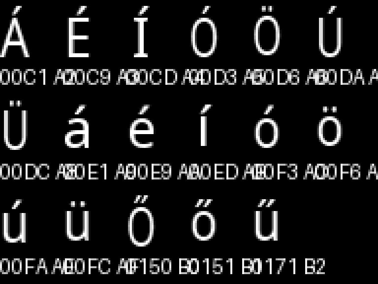
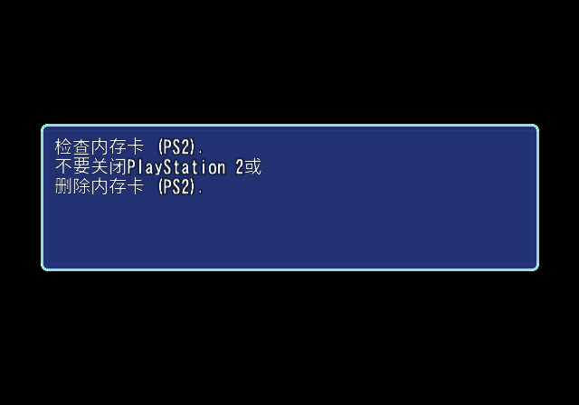
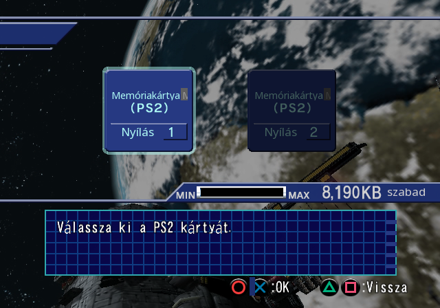
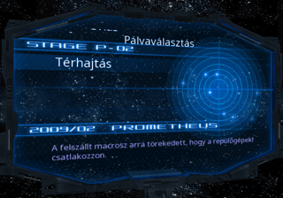
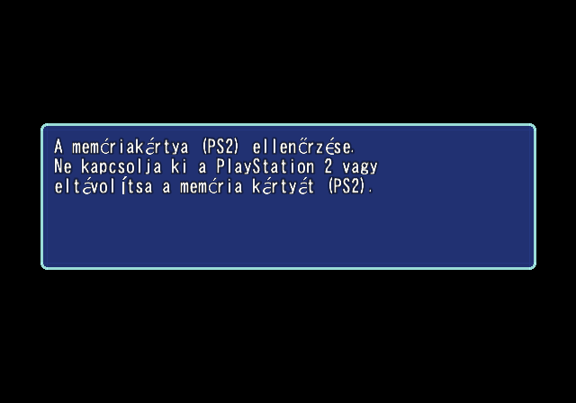

# Localization contributor guide

This is the primary guide for translators who want to add, review, or maintain
a runtime language. The port can replace text, fonts, and selected CVM files
without rebuilding the native executable or writing a patched disc. The
separate [external patched-image workflow](patched-image.md) is an advanced
compatibility reference for a pinned third-party ISO patcher; it is not needed
to contribute a runtime language.

Runtime localization is specific to Japanese `SLPM-65405`. Enabling a mod,
radio subtitles, or string export checks the boot target, executable size, and
original executable SHA-256:

```text
5e51cf5ecb8f344ccab90f7d99df04ff050fadba025579e4369c4abe0ebe75a1
```

The release project will ship the project-created multilingual translation CSV
and runtime translation functions. Release packaging excludes the raw
publisher export, its original Japanese source column, optional third-party
imports, and functional publisher-derived overlays unless they are separately
cleared for release. The low-resolution screenshots in `docs\images` are
documentation examples, not reusable source textures or game assets.

`-AllowPatchedImage` relaxes setup's executable SHA-1 check, but does **not**
bypass this runtime check. Use the original executable for runtime
localization; disable these features when using an externally patched
executable. The runtime executable check is not a whole-disc hash check.

## Tutorial: add a language

The runtime discovers language columns and launcher labels from files, so a
new human-translated language does not require recompiling the port. The
offline machine-translation and texture-rendering tools have explicit locale
lists that must also be extended when those tools are used.

This tutorial uses Italian (`it`) and NLLB language code `ita_Latn` as an
example. Substitute the appropriate portable BCP-47 tag, display name, model
language code, and font for the language being added.

### 1. Register the locale

Add a launcher label to
[`localization\multilingual-mt\mod.tsv`](../localization/multilingual-mt/mod.tsv):

```text
language.it	Italian
```

For a fully human-authored column, that manifest row and an `it` column in
`strings.csv` are sufficient for runtime discovery. To generate a machine
draft, add the model mapping to `LOCALES` in
[`tools\loc_mt.py`](../tools/loc_mt.py):

```python
"it": "ita_Latn",
```

To render localized title cards or fixed UI regions, also add `"it"` to
`LOCALES` in [`tools\loc_art.py`](../tools/loc_art.py). These are Python tool
changes and do not require recompiling the game.

### 2. Export the private source table

Complete [setup](../README.md#build), then export the Japanese table from a
matching original disc:

```powershell
.\port\macross-recomp.exe --export-strings `
  .\localization\_base\strings.csv
```

The export contains publisher text. Keep it under the ignored `_base`
directory, never add it to a pull request, and do not use `--with-ja` for a
release table.

### 3. Generate or author the new column

After registering the locale, this command preserves the existing release
columns and adds an unreviewed Italian draft to an ignored review file:

```powershell
python .\tools\loc_mt.py strings `
  .\localization\_base\strings.csv `
  -o .\.local\translations\multilingual-with-it.csv `
  --include-table .\localization\multilingual-mt\strings.csv `
  --locales it `
  --model .\.local\models\nllb-200-distilled-600M
```

A human translator can instead add the `it` column with a UTF-8 CSV editor.
Keep every `key` unchanged. Preserve printf conversions and intentional line
breaks, leave persistent save identifiers `t06.0017` through `t06.0023`
empty, and treat every machine-produced row as a draft requiring review.
Use an override table for hand-fitted executable strings and compact UI text
so repeatable generation does not overwrite editorial work.

### 4. Build and verify the font

Use a license-compatible local font containing every required character.
Noto Sans is available under the SIL Open Font License 1.1 and covers Italian
and the other Latin-script release languages:

```powershell
python .\tools\loc_csv.py font `
  .\.local\translations\multilingual-with-it.csv `
  --lang it `
  --font .\.local\fonts\noto-ofl\NotoSans-VF.ttf `
  --variation Regular `
  -o .\localization\multilingual-mt\languages\it\font.bin

python .\tools\loc_csv.py check `
  .\.local\translations\multilingual-with-it.csv `
  --base .\localization\_base\strings.csv `
  --lang it `
  --font .\localization\multilingual-mt\languages\it\font.bin
```

The checker rejects missing glyphs, broken printf conversions, malformed
keys, and executable strings that exceed their byte slots. Passing it does
not establish translation quality or prove that text fits every screen.

| Runtime font check | Example result |
|---|---|
| Hungarian accents fitted into the game's active glyph area |  |
| Simplified Chinese glyph forms selected instead of Japanese forms |  |

### 5. Translate texture-based text

Ordinary strings do not cover the memory-card atlases, main menu, stage
selection, or stage-title cards. Add the locale column to the private title
and UI TSVs, review the machine draft, and then use the
[stage-title renderer](#localized-stage-title-art) and
[fixed UI renderer](#mod-tables-and-file-overlays) with `--locales it`.
The generated files belong under:

```text
localization\multilingual-mt\languages\it\files\
```

Use the preview output before starting the game. Small fixed regions often
need shorter editorial overrides even when the literal translation is
correct.

| UI overlay check | Example result |
|---|---|
| Memory-card selector with translated labels, instructions, and button hints |  |
| Stage selection with translated heading, title, and description |  |

### 6. Test in the launcher and game

Start the launcher and select the new language:

```powershell
.\port\macross-recomp.exe --launcher
```

Check at least:

1. memory-card selection, save, load, and error dialogs;
2. main-menu and stage-selection labels;
3. stage-title cards;
4. mission briefings and radio captions;
5. accented, Cyrillic, or CJK glyphs in short and multiline text; and
6. preserved save identifiers and printf-substituted values.

Look for `?` replacement glyphs, clipped accents or descenders, overlapping
sprites, text outside fixed boxes, changed save names, and mistranslated
terminology. The following runtime sample shows the intended narrow accented
glyph spacing and manual wrapping:



### 7. Prepare a contribution

A language contribution should contain:

- the new project-created locale column without the raw `ja` source column;
- its `language.<tag>` launcher label;
- a generated `font.bin` and the required font-license notice when needed;
- tool locale mappings when machine generation or art rendering uses them;
- reviewed overrides for constrained strings; and
- functional overlays only after their redistribution status is approved.

Do not submit the disc image, extracted files, Japanese export, model files,
translation cache, optional third-party imports, or private review workbooks.
Include a short test report naming the screens and missions checked. The
automated checks are documented in [Testing](testing.md).

## Choosing options

After [setup](../README.md#build), start `.\port\macross-recomp.exe` from the
repository root. The launcher offers Japanese disc text, installed
localization mods, an independent project-authored English system-message
overlay, radio subtitles, Vulkan or software rendering, internal resolution,
Vulkan output upscaling, fullscreen, and whether to show the launcher on later
starts.
Keyboard, mouse, and controller navigation are implemented; controller
behavior still needs broader validation. F11 toggles fullscreen in-game.

- `.\port\macross-recomp.exe --play` skips the launcher.
- `.\port\macross-recomp.exe --launcher` forces it to appear.
- `.\port\macross-recomp.exe --export-strings
  .\localization\_base\strings.csv` exports the disc string table headlessly;
  export is intentionally command-line only.
- `.\tools\run.ps1 -Renderer Vulkan -Scale 1 -Upscaler FSR1` starts the game
  directly and overrides saved rendering options through environment
  variables. Add `-Launcher` to show the launcher instead. Its `-Headless`
  compatibility mode also skips saved settings.

### Included mods

| Mod | Contents and limits |
|---|---|
| `en-system` | 47 project-authored English executable-system messages, including memory-card, installation, calibration, and dialog text. The launcher can overlay these messages independently on any text language. |
| `en-fan` | A checked-in manifest for a player-supplied `localization\en-fan\strings.csv`. English system messages are selected independently in the launcher. |
| `multilingual-mt` | The release localization mod for English, Mexican Spanish, Brazilian Portuguese, Simplified Chinese, French, German, Hungarian, and Ukrainian. Its project-created `strings.csv` and runtime translation functions ship with the release. All eight generated columns are unreviewed machine drafts. |

Included mods are loaded first; later nonempty rows in the selected mod win.
The independent `en-system` table loads after the selected text table when its
launcher option is enabled, so its 47 project-authored rows take precedence
without changing story text. Other include chains still use their declared
order; include cycles and missing included mods are errors. The project's 47
strings are not the external image patch's 52 executable edits, and neither
count implies a complete translation.

The external full story translation is machine-produced and has not been
reviewed by a Japanese-speaking human. It is not vendored: its pinned revision
declares no explicit license. Optional CSVs imported from that checkout remain
private and are not part of the release. This restriction does not apply to
the project-created multilingual release CSV or runtime translation functions.

## Settings and migration

Settings are resolved independently for each option, in this order:

1. `MACROSS_*` environment variables, including explicitly empty values;
2. the player's `<data>\settings.tsv`, normally
   `.local\runtime\settings.tsv` after setup;
3. the repository's `settings.tsv`;
4. the framework's global settings; and
5. built-in defaults.

Setup records the player data directory in ignored `local.tsv`. The existing
repository/global settings remain in place and continue to be inherited; the
launcher does not bulk-copy or delete them. It atomically saves only options
the player changes, preserving unrelated player-file rows such as `IRX`,
`NATIVE`, and unknown settings. An environment override still wins after a
launcher edit for that run.

The launcher controls `SW`, `SCALE`, `UPSCALER`, `LOC`, `LANG`, `SUBTITLES`,
`FULLSCREEN`, and `LAUNCHER`. `UPSCALER` is `linear` or `fsr1`; it affects the
Vulkan presentation path only. `LOC` is a mod directory name and `LANG` is its
selected CSV language column. The checked-in repository settings select
Vulkan, scale 1, and FSR 1; software remains an explicit compatibility
fallback. The settings and controller features are not a substitute for
in-game compatibility testing.

## Subtitles

For supported voiced record tables, the runtime option changes record ID
byte 2 from ASCII `0` to `1` only when the original text contains Japanese
prose. It leaves `1`, `2`, `3`, and any other values unchanged. The meanings
of `2` and `3` are not fully established, and caption layout and behavior
still need testing across missions. The external image builder's subtitle
patch is a separate operation; its historical count of 1,811 enabled lines is
not a runtime coverage guarantee.

## Exporting and importing local text

The launcher's **Export string table** action boots a headless child until
the game loads its text, then writes
`localization\_base\strings.csv`. The same operation can be requested directly:

```powershell
.\port\macross-recomp.exe --export-strings .\localization\_base\strings.csv
```

The exported UTF-8 CSV contains publisher text. Its exact path is ignored by
Git and must remain private. Exporting to another path does not automatically
make that path ignored; keep other working copies under `.local\` and do not
commit them.

To populate `en-fan`, first obtain and inspect the external translation
checkout at the revision pinned in
[`recomp.lock.json`](../recomp.lock.json). After exporting the base table:

```powershell
python .\tools\loc_csv.py import-external `
  .\localization\_base\strings.csv `
  .\.deps\macross-translation `
  .\localization\en-fan\strings.csv

python .\tools\loc_csv.py check `
  .\localization\en-fan\strings.csv `
  --base .\localization\_base\strings.csv
```

The importer reads the checkout's baseline and machine-translation JSON by
default; append `--baseline-only` to import only its baseline. It reports
unmatched source entries and exits nonzero if any remain. The `en-fan` CSV is
also explicitly ignored. `--with-ja` includes publisher text and is for
private local work only.

[`tools/loc_csv.py`](../tools/loc_csv.py) also provides `merge` and `strip`.
`merge` produces a workbook containing the original Japanese, so write it to
ignored local storage. `strip` removes the Japanese column and some metadata,
but does not grant redistribution rights for fan text or other retained
content. The checker reports malformed/duplicate keys, unencodable
characters, executable slot budgets and printf conversions when a base is
provided, and optional line-width violations. `--lang` checks one language,
and repeatable `--font` options account for runtime glyph packs when measuring
encoding and byte budgets.

## Offline multilingual release table

[`tools/loc_mt.py`](../tools/loc_mt.py) translates only through a model that
already exists in a local directory. It sets Hugging Face's offline
environment switches before importing Transformers and uses
`local_files_only=True`; it never downloads a model or sends text to a
service. The local Python environment must already provide `torch`,
`transformers`, and `sentencepiece`.

Export the base table, then generate all seven language columns:

```powershell
python .\tools\loc_mt.py strings `
  .\localization\_base\strings.csv `
  -o .\localization\multilingual-mt\strings.csv `
  --include-table .\localization\en-system\strings.csv `
  --override-table .\.local\translations\executable-overrides.csv `
  --override-table .\.local\translations\text-overrides.csv `
  --model .\.local\models\nllb-200-distilled-600M
```

`--include-table` carries authorized project tables' English columns and
editorial notes into the multilingual release table. An optional private
`en-fan` import can still be included for a local build, but it is not part of
the release table. The seven new columns are translated directly from Japanese
rather than from English.
`--override-table` applies nonempty keyed cells after translation. Keep fitted
executable strings and manually wrapped fixed-window copy in ignored local
override tables so they survive cached regeneration without truncation.
Validate executable replacements against the base table because those slots
have fixed byte budgets.

The locale/model-language pairs are:

| Runtime locale | Local NLLB language |
|---|---|
| `es-MX` | `spa_Latn` |
| `pt-BR` | `por_Latn` |
| `zh-Hans` | `zho_Hans` |
| `fr` | `fra_Latn` |
| `de` | `deu_Latn` |
| `hu` | `hun_Latn` |
| `uk` | `ukr_Cyrl` |

NLLB produces generic Spanish and Portuguese, not a Mexican or Brazilian
dialect guarantee. Those columns require regional review. Every generated row
is marked `UNREVIEWED MACHINE TRANSLATION`. Exact printf tokens and both real
and escaped line breaks are protected; repeated source text is translated
once and saved in an adjacent ignored local cache. Three-token repetition
blocking and a `1.1` repetition penalty are enabled by default to prevent
runaway short-line loops. A model result that drops a protected token, changes
a line break, or returns an empty draft fails the operation. The
`facebook/nllb-200-distilled-600M` checkpoint is CC-BY-NC-4.0; confirm that its
noncommercial terms fit the intended use before distributing its output.

The game's original font cannot display all requested scripts. Build one
runtime glyph pack per locale from a locally supplied TTF, OTF, TTC, or OTC
font. Each glyph is stored in a 32-by-32 transfer tile, but the game font
renders only its upper-left 20-by-20 active area; the generator fits the
bitmap there before packing it. One-byte Latin and Cyrillic glyphs are
additionally condensed to the original narrow font's 11-pixel envelope so
they remain legible at the game's fixed 8-pixel advance. Pillow is required
locally. For example:

```powershell
python .\tools\loc_csv.py font `
  .\localization\multilingual-mt\strings.csv `
  --lang fr `
  --font .\.local\fonts\noto-ofl\NotoSans-VF.ttf `
  -o .\localization\multilingual-mt\languages\fr\font.bin

python .\tools\loc_csv.py check `
  .\localization\multilingual-mt\strings.csv `
  --base .\localization\_base\strings.csv `
  --lang fr `
  --font .\localization\multilingual-mt\languages\fr\font.bin
```

Noto Sans and Noto Sans SC are available under the SIL Open Font License 1.1.
Use Noto Sans for the Latin and Ukrainian locales. For `zh-Hans`, use Noto
Sans SC and add `--override-cjk` so even characters that CP932 can encode use
Simplified Chinese glyph forms instead of Japanese forms. The Noto Sans SC
variable font defaults to its Thin instance, so pass `--variation Regular`
when building that pack. Keep the OFL text with any redistributed font
assets. A pack is deterministic for its table and contains only needed
characters. Latin and Cyrillic glyphs use 67 audited one-byte codes so the
game gives them its normal narrow advance; CJK and other glyphs use 2,820
reserved two-byte codes. Generation fails rather than silently exceeding
either pool or using a missing font glyph.

## Localized stage-title art

Stage titles are 21 `SBTTL_*.CMP` files in `JPN.CVM`. They decompress directly
to a verified 512-by-128, indexed 4-bit TIM2 layout. Their PSMT4 pixels are
pre-swizzled for a PSMCT32 upload; the tool applies the GS page, block, and
column address mapping when exporting and replacing the image.
[`tools/loc_art.py`](../tools/loc_art.py) exports references and a local title
table, then renders translated rows into language overlay directories while
preserving each texture's header and palette. It requires Pillow and a
locally built CRICMP executable.

```powershell
python .\tools\extract_assets.py `
  "F:\path\to\Macross.iso" `
  JPN.CVM `
  .\.local\sbttl-cmp `
  --pattern "SBTTL_*.CMP"

python .\tools\loc_art.py extract `
  .\.local\sbttl-cmp `
  -o .\.local\sbttl-work `
  --cricmp .\.deps\cricmp\cricmp.exe
```

The extraction writes reference PNGs, decompressed TIM2 sources, and
`titles.tsv`. Transcribe each source title into its local `ja` column. The same
offline model can draft the eight release-language title columns:

```powershell
python .\tools\loc_mt.py titles `
  .\.local\sbttl-work\titles.tsv `
  -o .\.local\sbttl-work\titles-translated.tsv `
  --model "D:\local-models\nllb-200-distilled-600M"
```

Render one or more locales. Font assignments may use `all=PATH` or a separate
`LOCALE=PATH` for each script:

```powershell
python .\tools\loc_art.py render `
  .\.local\sbttl-work `
  .\.local\sbttl-work\titles-translated.tsv `
  -o .\localization\multilingual-mt `
  --cricmp .\.deps\cricmp\cricmp.exe `
  --font "all=.\.local\fonts\noto-ofl\NotoSans-VF.ttf" `
  --font "zh-Hans=.\.local\fonts\noto-ofl\NotoSansSC-VF.ttf" `
  --variation "zh-Hans=Regular"
```

The result lands at
`languages\<locale>\files\JPN.CVM\SBTTL_*.CMP` and is selected at runtime.
The original `STAGE:A-xx`, `STAGE:P-xx`, or `STAGE:00` footer is regenerated
under each localized title. Blank title cells are skipped. References, source
art, title tables, generated overlays, and publisher-derived translations are
ignored local files and must not be committed. The separate `render-ui`
workflow below handles the known memory-card, main-menu, and stage-select
atlases; other texture-driven UI still needs format-specific analysis.

## Mod tables and file overlays

A mod lives under `localization\<id>\`; names beginning with `_` or `.` are
not discovered as mods. It may provide a `strings.csv`, a `files` directory,
or both, with an optional `mod.tsv` manifest:

```text
localization\<id>\mod.tsv
localization\<id>\strings.csv
localization\<id>\files\JPN.CVM\<existing-root-file>
localization\<id>\languages\<tag>\font.bin
localization\<id>\languages\<tag>\files\JPN.CVM\<existing-root-file>
```

The UTF-8 CSV has a `key` column and one or more language columns, such as
`en` or `pt-BR`. Language columns must be portable BCP-47-style identifiers
because the same value names `languages\<tag>`. A manifest can map one to a
friendly launcher label with `language.<tag>`:

```text
language.es-MX	Spanish (Mexico)
language.zh-Hans	Chinese (Simplified)
```

The launcher prefixes multilingual choices with their language tag and uses a
compact ASCII bitmap font, so launcher labels should use printable ASCII.
Labels must correspond to real CSV columns. Keys are `tNN.IIII` for a
string-table entry or `exe.AAAAAAAA` for a supported executable address. The
runtime loads each table transactionally, rejects malformed or duplicate
entries, and falls back for missing text. An included mod whose table lacks
the selected language is skipped rather than making startup fail.

Text uses normal CP932/Shift-JIS where possible. A selected `font.bin` maps
additional Unicode characters to reserved one-byte narrow or two-byte wide
codes and supplies their 512-byte, 32-by-32, 4-bit transfer tiles at runtime.
Generated pixels are confined to the font's active 20-by-20 area so accents
and descenders are not clipped by the game's texture coordinates.
Latin and Cyrillic are deliberately remapped even when CP932 has a glyph so
proportional text does not receive Japanese full-width spacing. Unsupported
characters without a pack still become `?` and are reported. The manifest's
`ascii_punctuation` option defaults to enabled. Executable replacements must
fit their original slots and retain the original printf argument conversions;
otherwise those strings remain unchanged.

The version-1 pack format is little-endian: 8-byte magic `MCFNT1\0\0`, a
`u32` record count, then records containing `u32` Unicode code point, `u16`
game code, zero `u16` flags, and 512 glyph bytes. Narrow codes use audited
standalone bytes `80`, `A0`, `A2` through `DF`, and `FD` through `FF`. Wide
codes use the unused Shift-JIS lead ranges `85`, `86`, `EB`, `EC`, `EF`, and
`F0` through `F9` with normal Shift-JIS trails. Malformed packs, reused codes,
and conflicting duplicate mappings fail transactionally.

The seven records `t06.0017` through `t06.0023` are persistent memory-card
identifiers, not display copy. The machine-translation tool always leaves
their locale cells empty so the runtime preserves the original disc bytes.

The UI renderer supports the indexed PSMT4 and PSMT8 TIM2 layouts used by the
memory-card, main-menu, and stage-select atlases. The memory-card regions must
be applied to the outer ISO's `CRSDAT.MRG` as well as the `CRSDAT.MRG` and
`CRSDATAT.MRG` copies inside `JPN.CVM`; the startup selector reads the outer
copy. Fixed regions are described by `localization\ui-layout.json`; translated
UI TSVs and rendered publisher assets remain ignored local files. The
translation and optional override TSVs use an `id` column plus locale columns;
nonempty override cells replace the machine draft for compact fixed regions.
Manifest `clear` regions remove pixels shared with adjacent sprites before
localized text is rendered.
Render all eight release-language overlays with:

```powershell
python .\tools\loc_art.py render-ui `
  .\.local\analysis\ui `
  .\.local\translations\ui-translated.tsv `
  .\localization\ui-layout.json `
  -o .\localization\multilingual-mt `
  --cricmp .\.deps\cricmp\cricmp.exe `
  --override-table .\.local\translations\ui-overrides.tsv `
  --font all=.\.local\fonts\noto-ofl\NotoSans-VF.ttf `
  --font zh-Hans=.\.local\fonts\noto-ofl\NotoSansSC-VF.ttf `
  --variation all=Regular `
  --variation zh-Hans=Regular
```

Apply `patches\cricmp\0001-limit-repeat-token-length.patch` before building
the local CRICMP utility. The upstream encoder otherwise emits invalid copy
tokens for repeat runs longer than its 12-bit repeat field. Every compression
performed by `loc_art.py` is decompressed and compared byte-for-byte; a broken
encoder is rejected and its output is removed.

For file replacements, a regular file directly below `files` replaces a
same-size file at the outer ISO root. A directory below `files` names an
existing outer CVM and each file in it replaces an existing **root-level**
file inside that container. Names match case-insensitively; nested replacement
directories are not supported. A 2,048-byte-sector `.iso` is required. Common
mod files load first; the selected `languages\<tag>\files` directory loads afterward and
wins for the same asset. Later included mods can replace earlier files.

The overlay validates the image, directory metadata, file extents, and
replacement sizes before installing its read hook. Replacements can fit in
place or move to verified unallocated zero sectors inside or immediately
after a CVM. It serves replacement bytes and updated directory/volume fields
on reads, including both byte orders where applicable; it never rewrites the
source image. Missing files, unsafe overlaps, insufficient verified space,
or other preparation errors fail the whole installation rather than leaving a
partial overlay. Keep replacement files unchanged while the game is running.

Synthetic runtime tests exercise table loading, attribute preservation,
settings, discovery, include-language fallback, runtime font parsing and
glyph injection, localized overlay precedence, and overlay failure paths. See
[testing](testing.md) for the automated suites and the separate
exact-disc Vulkan smoke test. These checks do not prove full-game or visual
correctness.
